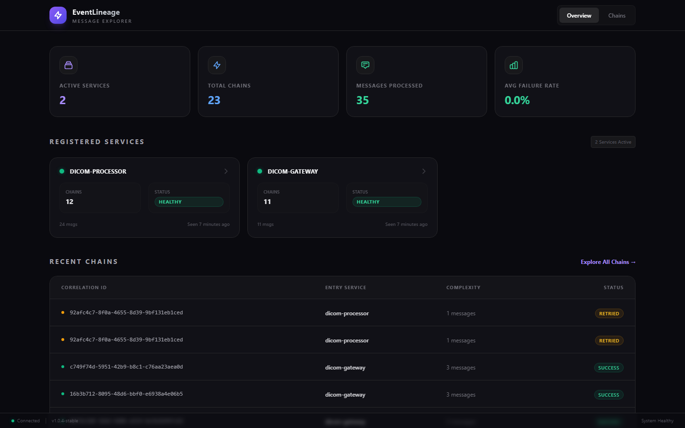
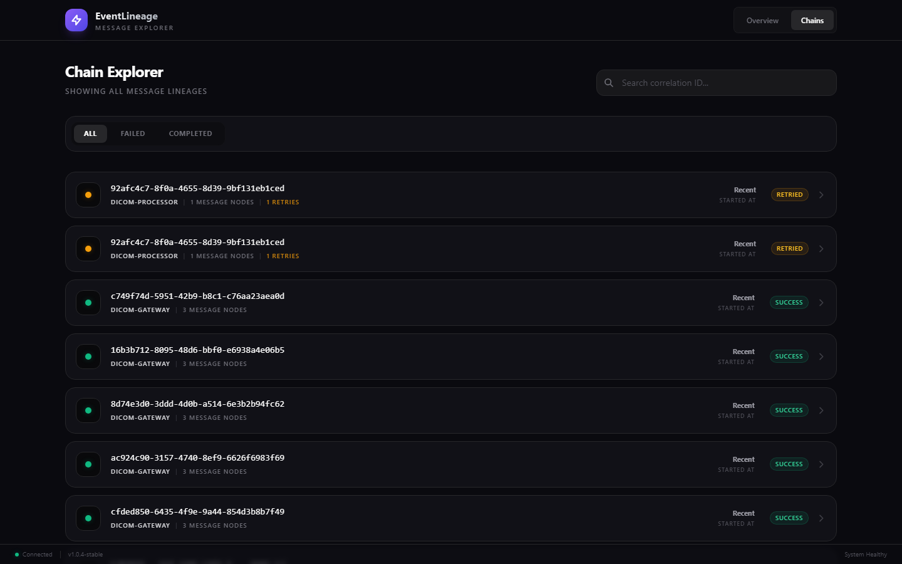
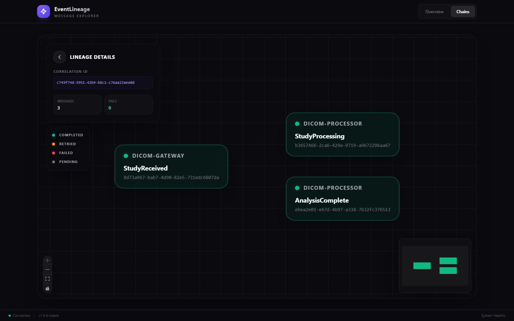
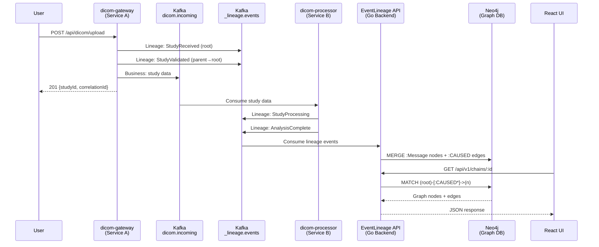

<p align="center">
  
</p>

<h1 align="center">EventLineage</h1>

<p align="center">
  <strong>A Message Lineage & Causality Engine for Kafka-based Microservices</strong>
</p>

<p align="center">
  <a href="#screenshots">Screenshots</a> &bull;
  <a href="#the-problem-the-causality-gap">The Problem</a> &bull;
  <a href="#the-solution">The Solution</a> &bull;
  <a href="#architecture">Architecture</a> &bull;
  <a href="#quick-start">Quick Start</a> &bull;
  <a href="#sdk-usage">SDK Usage</a> &bull;
  <a href="#how-i-built-it">How I Built It</a>
</p>

---

## Screenshots

### Dashboard — Service Overview & Recent Chains

> Real-time overview showing 2 active services (dicom-gateway, dicom-processor), 35 messages processed across 23 chains, registered service health cards, and a recent chains table with status badges (Success / Retried).

### Chain Explorer — Search, Filter & Browse Lineages

> Full chain listing with correlation ID search, status filters (All / Failed / Completed), service origin labels, message node counts, retry indicators, and status badges.

### Chain Graph — Interactive DAG Visualization

> Interactive directed acyclic graph (DAG) rendered with ReactFlow. Shows the causal chain: **StudyReceived** (dicom-gateway) → **StudyProcessing** (dicom-processor) → **AnalysisComplete** (dicom-processor). Includes lineage details panel, status legend, zoom controls, and minimap.

---

## The Problem: The Causality Gap

In distributed systems built on Kafka, services communicate through **asynchronous messages**. When something breaks, you face the hardest question in microservices debugging:

> *"This message failed, but what **caused** it? Which upstream event triggered this chain? What other downstream services were affected?"*

Traditional tracing tools (Jaeger, Zipkin) track **synchronous request-response** spans. But Kafka-based architectures are **asynchronous** — a message produced by Service A might be consumed by Service B minutes later, which then produces another message consumed by Service C. The causal chain is invisible:

```
Service A produces msg-1 ──► Kafka ──► Service B consumes msg-1
                                        └── produces msg-2 ──► Kafka ──► Service C consumes msg-2
                                                                          └── produces msg-3 (FAILED)

❌ Zipkin/Jaeger: "msg-3 failed" (no parent context — the trace is broken)
✅ EventLineage: "msg-3 failed ← msg-2 ← msg-1 (root cause: Service A)"
```

This is the **Causality Gap** — the inability to trace causal chains across asynchronous message boundaries.

---

## The Solution

EventLineage solves this by injecting **lineage metadata** into Kafka message headers via lightweight SDKs. Every message automatically carries:

- **Who am I?** (`messageId`)
- **Who is my parent?** (`parentId`)
- **What chain do I belong to?** (`correlationId`)
- **Why was I produced?** (`causationReason`)

These lineage events are emitted to a dedicated Kafka topic (`_lineage.events`), consumed by the EventLineage backend, and stored as a **causal graph** in Neo4j. The React UI visualizes these chains as interactive DAGs.

### Key Features

| Feature | Description |
|---------|-------------|
| **Zero-code Instrumentation** | SDK wraps your Kafka producer/consumer — no business logic changes |
| **Causal Graph Storage** | Neo4j stores parent-child relationships for O(1) traversal |
| **Chain Reconstruction** | Query any message to see its complete ancestry and descendants |
| **Visual DAG Explorer** | React + ReactFlow UI for interactive chain visualization |
| **Retry & Failure Detection** | Highlights retry storms and failed chains at a glance |
| **Multi-language SDKs** | Python SDK (production-ready) and Java SDK (interceptor-based) |
| **Idempotent Ingestion** | MERGE-based writes handle out-of-order and duplicate events |

---

## Architecture

### System Overview

```
                          ┌─────────────────────────────────────┐
                          │        YOUR MICROSERVICES           │
                          │                                     │
                          │  ┌──────────────┐  ┌─────────────┐ │
                          │  │  Service A    │  │  Service B   │ │
                          │  │ + Python SDK  │  │ + Python SDK │ │
                          │  └──────┬───────┘  └──────┬──────┘ │
                          │         │                  │        │
                          └─────────┼──────────────────┼────────┘
                                    │                  │
                      ┌─────────────▼──────────────────▼─────────────┐
                      │              APACHE KAFKA                     │
                      │                                               │
                      │  ┌─────────────────┐  ┌───────────────────┐  │
                      │  │ Business Topics  │  │ _lineage.events   │  │
                      │  │ (dicom.incoming) │  │ (lineage tracking)│  │
                      │  └─────────────────┘  └─────────┬─────────┘  │
                      │                                  │            │
                      └──────────────────────────────────┼────────────┘
                                                         │
                                              ┌──────────▼──────────┐
                                              │  EventLineage API   │
                                              │  (Go 1.22 / Gin)    │
                                              │                     │
                                              │  • Kafka Consumer   │
                                              │  • REST API Server  │
                                              │  • CORS Middleware   │
                                              └──────────┬──────────┘
                                                         │
                                              ┌──────────▼──────────┐
                                              │      Neo4j 5.x      │
                                              │  (Graph Database)    │
                                              │                     │
                                              │  [:Message] nodes   │
                                              │  [:CAUSED] edges    │
                                              └──────────┬──────────┘
                                                         │
                                              ┌──────────▼──────────┐
                                              │     React UI        │
                                              │  (React 18 + Vite)  │
                                              │                     │
                                              │  • Dashboard        │
                                              │  • Chain Explorer   │
                                              │  • DAG Visualizer   │
                                              └─────────────────────┘
```

### Data Flow Sequence



### Neo4j Graph Schema

```
┌─────────────────────────────────────────────────────────┐
│                    :Message Node                         │
├─────────────────────────────────────────────────────────┤
│  messageId       : STRING  (unique, indexed)            │
│  correlationId   : STRING  (indexed)                    │
│  rootMessageId   : STRING  (indexed)                    │
│  parentId        : STRING                               │
│  serviceOrigin   : STRING  (indexed)                    │
│  topic           : STRING                               │
│  causationReason : STRING                               │
│  status          : STRING  (ok | failed | pending)      │
│  retryCount      : INTEGER                              │
│  timestamp       : DATETIME (indexed)                   │
│  payloadPreview  : STRING  (max 500 chars)              │
│  tenantId        : STRING                               │
└─────────────────────────────────────────────────────────┘
           │
           │ [:CAUSED]
           │   reason    : STRING
           │   createdAt : DATETIME
           ▼
┌─────────────────────────────────────────────────────────┐
│                    :Message Node                         │
│                  (child message)                         │
└─────────────────────────────────────────────────────────┘
```

**Indexes & Constraints:**
```cypher
CREATE CONSTRAINT message_unique FOR (m:Message) REQUIRE m.messageId IS UNIQUE;
CREATE INDEX FOR (m:Message) ON (m.correlationId);
CREATE INDEX FOR (m:Message) ON (m.rootMessageId);
CREATE INDEX FOR (m:Message) ON (m.serviceOrigin);
CREATE INDEX FOR (m:Message) ON (m.timestamp);
CREATE INDEX FOR (m:Message) ON (m.status);
```

**Key Design Decisions:**
- **MERGE not CREATE** — idempotent writes handle Kafka redeliveries and out-of-order arrival
- **COALESCE on match** — first real value wins; stub nodes get filled without overwriting
- **Parent stub creation** — edge MERGE creates stub parent if child arrives first (eventually consistent)

---

## Tech Stack

| Layer | Technology | Why |
|-------|-----------|-----|
| **Message Broker** | Apache Kafka 7.5 | Industry standard for event-driven architectures |
| **Backend API** | Go 1.22 + Gin | High-throughput Kafka consumer + REST API in a single binary |
| **Graph Database** | Neo4j 5.15 Community | Native graph traversal for causal chain queries |
| **Frontend** | React 18 + TypeScript + Vite | Modern SPA with ReactFlow for DAG visualization |
| **UI Styling** | Tailwind CSS 3 | Custom dark theme with glassmorphism design system |
| **Data Fetching** | TanStack Query | Automatic caching, polling, and stale-while-revalidate |
| **Graph Rendering** | @xyflow/react (ReactFlow) | Interactive node-edge visualization with minimap |
| **Containerization** | Docker Compose | Full-stack orchestration with health checks |
| **SDKs** | Python (confluent-kafka) / Java (interceptors) | Zero-code instrumentation for existing services |

---

## Project Structure

```
EventLineage/
├── backend/                       # Go backend (API + Kafka consumer)
│   ├── cmd/server/main.go         # Entry point
│   ├── internal/
│   │   ├── api/                   # REST handlers (chains, messages, services)
│   │   │   ├── router.go          # Route definitions
│   │   │   ├── chain_handler.go   # GET /api/v1/chains, GET /api/v1/chains/:id
│   │   │   ├── message_handler.go # GET /api/v1/messages/:id
│   │   │   ├── service_handler.go # GET /api/v1/services
│   │   │   └── health_handler.go  # GET /health, GET /ready
│   │   ├── kafka/consumer.go      # Kafka consumer with 3-retry + exponential backoff
│   │   └── store/                 # Neo4j repositories
│   │       ├── neo4j.go           # Connection pool + migrations
│   │       ├── message_repo.go    # UpsertMessage (MERGE + CAUSED edges)
│   │       ├── chain_repo.go      # GetChain, ListChains (graph traversal)
│   │       └── service_repo.go    # ListServices, GetServiceStats
│   ├── pkg/envelope/              # Lineage event schema + header constants
│   │   ├── event.go               # LineageEvent struct (16 fields)
│   │   └── headers.go             # Header key constants
│   ├── Dockerfile                 # Multi-stage Go build (golang:1.22 → alpine:3.19)
│   └── go.mod
│
├── ui/                            # React frontend
│   ├── src/
│   │   ├── App.tsx                # Shell: nav bar, routing, status footer
│   │   ├── api/client.ts          # Typed Axios client + TypeScript interfaces
│   │   ├── components/
│   │   │   ├── ServiceList.tsx    # Dashboard: stats cards, services grid, chains table
│   │   │   ├── ChainExplorer.tsx  # Chain listing: search, filters, chain cards
│   │   │   ├── ChainGraph.tsx     # ReactFlow DAG: custom nodes, animated edges, minimap
│   │   │   └── MessagePanel.tsx   # Message detail sidebar: metadata, payload preview
│   │   ├── hooks/
│   │   │   ├── useChain.ts        # TanStack Query hooks for chains
│   │   │   └── useServices.ts    # TanStack Query hook for services
│   │   └── index.css              # Tailwind base + .glass, .badge component classes
│   ├── tailwind.config.js         # Custom tokens: surface-dark/card/border, brand-violet
│   ├── nginx.conf                 # Production reverse proxy (/api → backend:8080)
│   ├── Dockerfile                 # Multi-stage build (node:20 → nginx:alpine)
│   └── package.json
│
├── sdk/
│   ├── python/                    # Python SDK (pip install ./sdk/python)
│   │   ├── eventlineage/
│   │   │   ├── __init__.py        # Public exports
│   │   │   ├── producer.py        # LineageProducer: wraps confluent-kafka Producer
│   │   │   ├── consumer.py        # LineageConsumer: wraps confluent-kafka Consumer
│   │   │   ├── context.py         # Async-safe context propagation (contextvars)
│   │   │   ├── event.py           # LineageEvent dataclass + serialization
│   │   │   └── headers.py         # Header key constants (matches Go backend)
│   │   └── pyproject.toml         # Package config (setuptools)
│   └── java/                      # Java SDK (Kafka interceptor-based)
│       ├── src/main/java/io/eventlineage/kafka/
│       │   ├── LineageProducerInterceptor.java
│       │   ├── LineageConsumerInterceptor.java
│       │   ├── LineageContext.java
│       │   ├── LineageEvent.java
│       │   └── LineageHeaders.java
│       └── pom.xml
│
├── services/                      # Demo microservices (DICOM imaging pipeline)
│   ├── dicom-gateway/             # Service A: study upload + validation
│   │   ├── app.py                 # Flask: POST /api/dicom/upload, GET /api/dicom/studies
│   │   ├── Dockerfile             # python:3.12-slim + SDK install
│   │   └── requirements.txt       # flask, confluent-kafka, flask-cors
│   └── dicom-processor/           # Service B: background Kafka consumer + analysis
│       ├── app.py                 # Flask + background consumer thread
│       ├── Dockerfile
│       └── requirements.txt
│
├── docker-compose.yml             # 7 services: zookeeper, kafka, neo4j, api, ui, gateway, processor
├── Makefile                       # Build/test/run shortcuts
└── HOW_IT_WORKS.md                # Detailed step-by-step flow walkthrough
```

---

## Quick Start

### Prerequisites
- Docker & Docker Compose
- ~4GB disk space (Kafka + Neo4j images)

### 1. Clone and Start

```bash
git clone https://github.com/ShivaBollam07/EventLineage.git
cd EventLineage
docker compose up --build -d
```

This starts **7 containers**:

| Service | Port | Description |
|---------|------|-------------|
| React UI | [localhost:3000](http://localhost:3000) | Dashboard, Chain Explorer, DAG Visualizer |
| Go API | [localhost:8080](http://localhost:8080) | REST API + Kafka consumer |
| Neo4j Browser | [localhost:7474](http://localhost:7474) | Graph database UI (login: `neo4j` / `eventlineage`) |
| Kafka | localhost:9092 | Message broker |
| Zookeeper | localhost:2181 | Kafka coordination |
| DICOM Gateway | [localhost:5001](http://localhost:5001) | Service A (study uploads) |
| DICOM Processor | [localhost:5002](http://localhost:5002) | Service B (background processing) |

### 2. Send Your First Study

```bash
curl -X POST http://localhost:5001/api/dicom/upload \
  -H "Content-Type: application/json" \
  -d '{
    "patientName": "Sarah Mitchell",
    "patientId": "PAT-20261204",
    "modality": "CT",
    "studyDescription": "Chest CT with Contrast",
    "numInstances": 128
  }'
```

Response:
```json
{
  "message": "Study uploaded and validated",
  "studyId": "b2ced2b7-...",
  "correlationId": "e2de6cff-...",
  "lineageUrl": "/chains/e2de6cff-..."
}
```

### 3. View the Chain

Open [localhost:3000](http://localhost:3000) and click on the chain to see the full DAG:

```
[StudyReceived]  →  [StudyValidated]  →  [StudyProcessing]  →  [AnalysisComplete]
 dicom-gateway       dicom-gateway        dicom-processor       dicom-processor
```

### 4. Query in Neo4j

Open [localhost:7474](http://localhost:7474), login with `neo4j` / `eventlineage`, select the **`neo4j`** database (not `system`), and run:

```cypher
MATCH (n:Message)-[r:CAUSED]->(m:Message) RETURN n, r, m
```

---

## Demo Walkthrough

### The DICOM Imaging Pipeline

The included demo simulates a **medical imaging (DICOM) pipeline** with two microservices:

**Service A: `dicom-gateway`** (Port 5001)
- Receives DICOM study uploads via REST API
- Validates DICOM headers (modality, patient ID, series)
- Forwards validated studies to Kafka for processing
- Emits lineage events: `StudyReceived` → `StudyValidated`

**Service B: `dicom-processor`** (Port 5002)
- Consumes studies from Kafka in a background thread
- Parses DICOM tags and runs analysis (simulated)
- Produces results and completion events
- Emits lineage events: `StudyProcessing` → `AnalysisComplete`

### Sending Multiple Studies

```bash
# CT Scan
curl -X POST http://localhost:5001/api/dicom/upload \
  -H "Content-Type: application/json" \
  -d '{"patientName":"Sarah Mitchell","modality":"CT","studyDescription":"Chest CT with Contrast","numInstances":128}'

# MRI Brain
curl -X POST http://localhost:5001/api/dicom/upload \
  -H "Content-Type: application/json" \
  -d '{"patientName":"James Rodriguez","modality":"MRI","studyDescription":"Brain MRI T1 Weighted","numInstances":256}'

# X-Ray
curl -X POST http://localhost:5001/api/dicom/upload \
  -H "Content-Type: application/json" \
  -d '{"patientName":"Emily Chen","modality":"XR","studyDescription":"PA Chest X-Ray","numInstances":2}'
```

### Triggering a Retry Chain

```bash
# Get a studyId from the processor results
STUDY_ID=$(curl -s http://localhost:5002/api/processor/results \
  | python -c "import sys,json; print(json.load(sys.stdin)['results'][0]['studyId'])")

# Reprocess it (creates a chain with retryCount > 0)
curl -X POST "http://localhost:5002/api/processor/reprocess/$STUDY_ID"
```

Retry chains appear with **amber badges** in the UI, making retry storms immediately visible.

---

## API Reference

### EventLineage API (Port 8080)

| Method | Endpoint | Description |
|--------|----------|-------------|
| `GET` | `/api/v1/services` | List all services with message counts and failure rates |
| `GET` | `/api/v1/services/:name` | Get stats for a specific service |
| `GET` | `/api/v1/chains` | List chains (`?service=`, `?status=`, `?limit=`, `?offset=`) |
| `GET` | `/api/v1/chains/:correlationId` | Full chain graph (nodes + edges + metadata) |
| `GET` | `/api/v1/messages/:messageId` | Message with parent and children |
| `GET` | `/health` | Health check |
| `GET` | `/ready` | Readiness (verifies Neo4j + Kafka) |

### DICOM Gateway (Port 5001)

| Method | Endpoint | Description |
|--------|----------|-------------|
| `POST` | `/api/dicom/upload` | Upload a DICOM study (triggers chain) |
| `GET` | `/api/dicom/studies` | List all uploaded studies |
| `GET` | `/health` | Health check |

### DICOM Processor (Port 5002)

| Method | Endpoint | Description |
|--------|----------|-------------|
| `GET` | `/api/processor/results` | List all processed results |
| `POST` | `/api/processor/reprocess/:studyId` | Re-trigger processing (retry chain) |
| `GET` | `/health` | Health check |

---

## SDK Usage

### Python SDK

Install:
```bash
pip install ./sdk/python
```

**Producer — wraps confluent-kafka:**
```python
from eventlineage import LineageProducer

producer = LineageProducer(
    bootstrap_servers="localhost:9092",
    service_name="payment-service"
)

# Produces to business topic + emits lineage event to _lineage.events
correlation_id = producer.produce(
    topic="orders.processed",
    value={"orderId": "ORD-123", "amount": 99.99},
    key="ORD-123",
    causation_reason="PaymentProcessed"
)
```

**Consumer — wraps confluent-kafka:**
```python
from eventlineage import LineageConsumer

consumer = LineageConsumer(
    bootstrap_servers="localhost:9092",
    group_id="payment-service",
    service_name="payment-service",
    topics=["orders"]
)

# Consuming auto-sets lineage context via contextvars
for msg in consumer:
    order = msg.value_json()
    print(f"Chain: {msg.correlation_id}")

    # This produce() automatically links as a child of the consumed message
    producer.produce(
        topic="payments.completed",
        value={"orderId": order["id"], "status": "paid"},
        causation_reason="PaymentConfirmed"
    )
```

**How the SDK works internally:**
1. `LineageProducer.produce()` generates a `messageId`, injects lineage headers into the Kafka message, and emits a lineage event to `_lineage.events`
2. `LineageConsumer` extracts lineage headers from consumed messages and sets an async-safe `contextvars` context
3. When a producer detects an active context, it automatically links the new message as a child
4. This creates the parent-child chain without any business logic changes

### Java SDK — Zero-code via Interceptors

```properties
# Add to your Kafka producer config
interceptor.classes=io.eventlineage.kafka.LineageProducerInterceptor
lineage.service.name=payment-service

# Add to your Kafka consumer config
interceptor.classes=io.eventlineage.kafka.LineageConsumerInterceptor
lineage.service.name=payment-service
```

No code changes required — the interceptors handle lineage tracking transparently.

---

## Lineage Protocol

Every message carries lineage metadata in **Kafka headers**:

| Header Key | Description | Example |
|------------|-------------|---------|
| `x-lineage-message-id` | Unique message ID | `826a71f2-...` |
| `x-lineage-parent-id` | Parent message ID | `f3a8b1c2-...` |
| `x-lineage-correlation-id` | Shared across entire chain | `e2de6cff-...` |
| `x-lineage-root-id` | First message in chain | `826a71f2-...` |
| `x-lineage-service` | Producing service name | `dicom-gateway` |
| `x-lineage-causation-reason` | Why this message was produced | `StudyValidated` |
| `x-lineage-retry-count` | Retry attempt number | `0` |

The lineage events (separate from business messages) are published to the `_lineage.events` topic:

```json
{
  "eventType": "produced",
  "messageId": "826a71f2-...",
  "parentId": null,
  "correlationId": "e2de6cff-...",
  "rootMessageId": "826a71f2-...",
  "serviceOrigin": "dicom-gateway",
  "topic": "dicom.incoming",
  "causationReason": "StudyReceived",
  "status": "ok",
  "retryCount": 0,
  "timestamp": "2026-04-05T10:39:29Z",
  "payloadPreview": "{\"studyId\":\"b2ced2b7-...\",\"modality\":\"CT\"}"
}
```

---

## How I Built It

### Design Thinking

1. **Identified the gap**: Existing observability tools (Jaeger, Zipkin, Datadog) trace synchronous request-response flows. In event-driven architectures, the causal chain breaks at Kafka boundaries. I needed a tool that tracks **asynchronous causality**.

2. **Chose the right data structure**: Causal chains are inherently a **directed acyclic graph (DAG)**. Neo4j's native graph traversal (`-[:CAUSED*]->`) gives O(depth) chain reconstruction, vs O(n) with relational databases using recursive CTEs.

3. **Zero-code instrumentation**: The SDK wraps Kafka's producer/consumer, injecting lineage headers transparently. Services don't need to change business logic — just swap `Producer` → `LineageProducer`.

4. **Separation of concerns**: Business messages flow on normal Kafka topics. Lineage events flow on a **separate** `_lineage.events` topic. This means lineage tracking has zero impact on business message throughput or latency.

5. **Idempotent ingestion**: The Go backend uses Cypher `MERGE` (not `CREATE`) with `COALESCE` on match. This handles:
   - **Kafka redeliveries** — same event arrives twice (no duplicates)
   - **Out-of-order arrival** — child arrives before parent (stub node created, filled later)
   - **Concurrent writes** — multiple consumer instances writing simultaneously

### Implementation Highlights

**Go Backend: Single Binary, Dual Role**
- Kafka consumer goroutine ingests lineage events while the Gin HTTP server serves the REST API — both in one binary
- Manual Kafka offset commits — only committed **after** successful Neo4j write (at-least-once delivery guarantee)
- 3-attempt retry with exponential backoff (capped at 16s) for Neo4j write failures
- CORS middleware for frontend development

**Python SDK: Context Propagation via `contextvars`**
- Uses Python's `contextvars` module for async-safe lineage context (works with asyncio, threading, and greenlets)
- `LineageConsumer` extracts headers and calls `set_current_context()` on every consume
- `LineageProducer` checks `get_current_context()` and automatically sets `parentId` to the consumed message
- Result: `consume → process → produce` builds the DAG with zero manual wiring

**React UI: Custom Dark Theme + ReactFlow**
- Custom Tailwind tokens (`surface-dark`, `surface-card`, `brand-violet`) for consistent glassmorphism design
- ReactFlow custom nodes with status-aware coloring (emerald/amber/red for ok/retry/failed)
- Depth-based node positioning for clean horizontal DAG layouts
- Animated edges for pending nodes, minimap for navigation

---

## Development

### Run Locally (Without Full Docker)

```bash
# Start infrastructure only
docker compose up -d zookeeper kafka neo4j

# Terminal 1: Go backend
cd backend
export NEO4J_URI=bolt://localhost:7687 NEO4J_USER=neo4j NEO4J_PASSWORD=eventlineage KAFKA_BROKERS=localhost:9092
go run ./cmd/server

# Terminal 2: React UI (hot reload on :3000)
cd ui && npm install && npm run dev

# Terminal 3: DICOM Gateway
cd services/dicom-gateway
pip install -r requirements.txt && pip install ../../sdk/python
python app.py

# Terminal 4: DICOM Processor
cd services/dicom-processor
pip install -r requirements.txt && pip install ../../sdk/python
python app.py
```

### Useful Neo4j Queries

```cypher
-- See all chains as a graph
MATCH (n:Message)-[r:CAUSED]->(m:Message) RETURN n, r, m

-- Find failed chains
MATCH (m:Message {status: 'failed'}) RETURN m

-- Trace a specific chain from root to leaves
MATCH path = (root:Message {correlationId: $cid})-[:CAUSED*0..20]->(n)
WHERE NOT ()-[:CAUSED]->(root)
RETURN path

-- Service message counts
MATCH (m:Message)
RETURN m.serviceOrigin AS service, count(m) AS messages
ORDER BY messages DESC
```

---

## License

MIT
